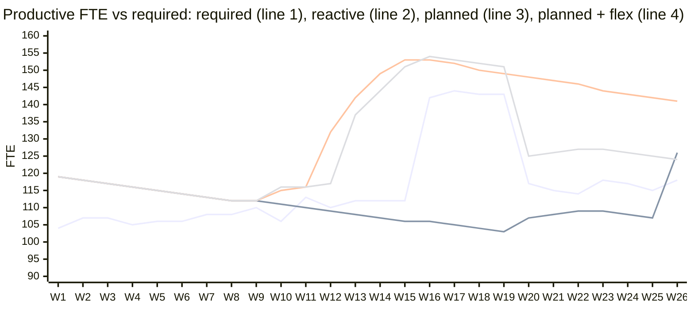

# Peak-Season Hiring Plan: When to Hire, and How Many?

    

> **Data note:** all data is **simulated**. No company or customer data is used.

## Business problem

A 120-person support team faces a 4-week festive peak. Hiring takes 6 weeks and new joiners need another 6 weeks to become fully productive, while about 3.4% of the team leaves every month. HR and finance need to know when to open requisitions, how many to hire, and how to avoid paying for surplus staff after the peak.

| | |
|---|---|
| **Who asks** | Operations head, HR / talent acquisition, finance |
| **Data used** | Weekly demand forecast with growth and a festive peak, handle time, shrinkage, attrition rate, hiring lead time and ramp curve |
| **Approach** | Built a 26-week supply vs demand model and compared three hiring strategies on understaffed weeks, peak coverage, total hires and surplus after the peak |

## Recommendation

Hire permanent staff 12 weeks ahead for the baseline only, and cover the peak with a temporary batch trained in advance. It gives full peak coverage like planned hiring, but cuts the post-peak surplus from about 28 FTE to about 10.



## Inputs and assumptions

| Input | Value |
|---|---|
| Starting headcount | 120 agents |
| Contacts | ~24k/week, +0.6% weekly growth, **+25% festive peak in weeks 16–19** |
| AHT / occupancy / shrinkage | 360 s / 85% / 32% |
| Attrition | 0.8% per week (~3.4% per month) |
| Hiring lead time | 6 weeks (requisition → joining) |
| Training + ramp | 3 weeks classroom, then 50% → 70% → 90% productivity |

So a hire raised today is **not fully productive for 12 weeks**.

## Options compared

- **A. Reactive:** raise a hiring request when the gap shows up.
- **B. Planned:** raise requests 12 weeks ahead of need, including expected attrition.
- **C. Planned + flex:** plan permanent hiring to the *baseline* and cover the peak with a temporary batch trained ahead and released after the peak.

## Findings

| Strategy | Weeks understaffed | Worst gap (FTE) | Peak coverage | Hires | Avg overstaff after peak (FTE) |
|---|---:|---:|---:|---:|---:|
| A. Reactive | **15 of 26** | −40.6 | **73%** | 50 | 1.1 |
| B. Planned | 0 | +1.5 | 106% | 50 | **28.1** |
| C. Planned + flex | 0 | +1.5 | 107% | 60 (30 temp) | **9.5** |

- **Reactive hiring fails the peak.** With a 12-week pipeline, hires requested when the gap appears land after the peak is over. Peak coverage is only 73%, with a gap of up to 41 FTE.
- **Planning ahead fixes the peak but creates a hangover.** Hiring permanent staff for a 4-week peak leaves ~28 surplus FTE for the rest of the plan.
- **Planned + flex gets the best of both.** Same zero understaffed weeks, and post-peak surplus drops from ~28 to ~10 FTE.
- **Attrition is a silent hiring need.** At 3.4% per month, ~41 of 120 agents leave in a year. Every plan has to backfill before it grows.

Full tables: [`outputs/RESULTS.md`](outputs/RESULTS.md) · weekly plan: [`outputs/weekly_plan.csv`](outputs/weekly_plan.csv)

## Run it

```bash
pip install -r requirements.txt
python capacity_plan.py
```

## About me

I'm Rahul, a Business Analyst in operations and CX analytics, based in Gurugram (currently at Shiprocket, before that DTDC Express). I build these small case studies on made-up data to practise the kind of business questions I work on, so nothing confidential leaves work. Feedback is welcome.

[LinkedIn](https://www.linkedin.com/in/rahul-219543159/) · [GitHub profile](https://github.com/mail4rahulwork-sketch)

**Other case studies**
- [Why did service level collapse in the festive peak? (Power BI)](https://github.com/mail4rahulwork-sketch/service-performance-powerbi-analysis)
- [Sale-week support demand: where should the extra budget go?](https://github.com/mail4rahulwork-sketch/sale-week-support-demand-analysis)
- [SLA early-warning rules: is acting early worth the cost?](https://github.com/mail4rahulwork-sketch/sla-early-warning-analysis)
- [Demand forecast to staffing cost: how much can we save?](https://github.com/mail4rahulwork-sketch/demand-forecast-staffing-cost-analysis)
